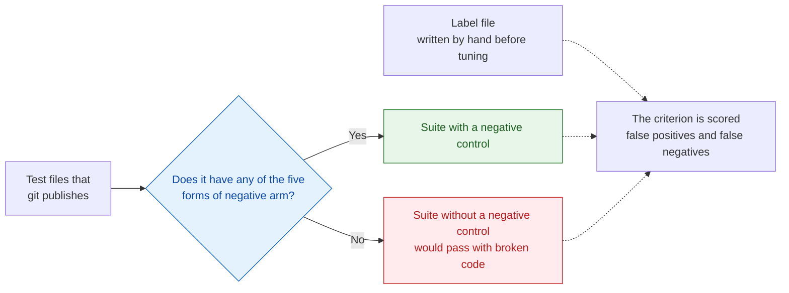

Versión en español: [README.md](README.md)

# skill-detector-control-negativo

> This repository is the package you install as a Claude Code plugin. The method and the figures are in [detector-control-negativo](https://github.com/jleonceo/detector-control-negativo).

> **Read this first: the tool speaks Spanish, and this page does not change that.** Every line it
> prints, the five signal names (`MARCA`, `ASSERT_NEG`, `ESPERA_CERO`, `NOMBRE_NEG`,
> `ETIQUETA_NEG`), the five flags and the three YAML keys (`banco`, `tiene_control_negativo`,
> `evidencia`) are Spanish. The label value `agregador` means "aggregator". This page is the
> reference for that vocabulary, and not a localised program.
>
> **Two words used throughout.** A *test suite* is what the tool calls `banco`, the Spanish for
> bench. Its *negative arm* is the case a test suite includes on purpose so that it fails; without
> one, a test suite stays green over working code and over broken code alike, so its green says
> nothing.

## What it does



It counts test suites, and says why for each one.

A test suite that only checks the happy path is fed a valid input, asserts the correct result, and
stops there. It is green. It stays green after somebody breaks input validation, because it is
never asked what happens with a bad input. What it lacks is the **negative control**: the case
asserting what the tool must reject, block, leave empty or flag as invalid.

The skill walks the test suites git publishes in your repository, looks for five shapes of negative
arm and returns how many test suites have none.

That is all. No language model involved, no network, no dependencies, and it writes nowhere.

## Install

Three ways. The first is the short one and the last always works.

```bash
# 1. As a Claude Code plugin
/plugin marketplace add jleonceo/skill-detector-control-negativo
/plugin install detector-control-negativo@skill-detector-control-negativo

# 2. By copying the folder into your personal skills
git clone https://github.com/jleonceo/skill-detector-control-negativo
cp -r skill-detector-control-negativo/skills/detector-control-negativo ~/.claude/skills/

# 3. Without installing anything, running the script directly
python skills/detector-control-negativo/verificar_control_negativo.py --raiz .
```

The example in `ejemplo/` runs with nothing to prepare. It is where the output block at the top of
this page comes from, all 32 lines of it with none removed:

```bash
python skills/detector-control-negativo/verificar_control_negativo.py \
  --etiquetas ejemplo/etiquetas_ejemplo.yaml --listar
```

**That "2 of 8" describes no real repository: the eight test suites in `ejemplo/bancos/` are planted on
purpose, one by one, each with its label beside it.** Two with no negative arm, which are the two
the report flags; five with one, one per signal; and one aggregator, for the label's third value.
The ninth test suite of that universe is the skill's own. It is a toy tree, built so every verdict can be
checked by reading the file, and on your repository the split will be a different one.

**That carries a practical consequence worth knowing before you clone.** Those fixtures are the
material the detector MEASURES, so several of them call symbols that do not exist on purpose and
would fail if anybody ran them as tests. They are named `test_*.py` because the detector's criterion
is the filename, and renaming them would drop them out of their own measurement. The exclusion lives
in `conftest.py` with the reason written inside, and today `python -m pytest -q` over this
repository collects 38 tests, all 38 from the skill's own test suite, and comes out green without
touching a single fixture.

The third way exists because the instrument does not need Claude Code. It is a standard library
script that asks `git ls-files` for its universe. If all you want is the number, it hands it over
without touching your configuration.

## Usage

```bash
cd your-repository
python ~/.claude/skills/detector-control-negativo/verificar_control_negativo.py --etiquetar
```

**The first run on a new repository exits with `2`, and rightly so.** There are no labels yet, and
without them the count is an unscored approximation. The path is `--etiquetar`, which prints the
YAML template for the test suites with no label, then opening those files by hand and writing the
label with the line that proves it. That time is the work and there is no shortcut: measuring a
test suite means reading it.

These are the five options, which is all of them:

| Option | What for |
|---|---|
| `--raiz PATH` | the tree to measure; by default, the git root of the current directory |
| `--etiquetas FILE` | the reference truth the detector is scored against |
| `--excluir SUBSTRING` | drops paths containing it; repeatable, and counted separately |
| `--listar` | every test suite with its verdict, and every verdict with the signal that fired |
| `--etiquetar` | a YAML template for the test suites that have no label yet |

Start with `--listar`.

That view heads off the most expensive misunderstanding. The skill recognises the negative arm by
shape, and your project's shapes need not resemble anyone else's: if your test suite wraps its
assertion in a helper of its own, or marks its negative cases by a different convention,
`--listar` shows it at a glance. Every covered test suite comes out with the signal that fired, so you
can see whether the criterion is recognising what you mean by a negative arm or counting something
else.

## The label file

```yaml
etiquetas:
  - banco: tests/test_parser.py                # test file
    tiene_control_negativo: true               # has a negative control
    evidencia: "self.assertRaises(ValueError) in test_rechaza_cabecera_vacia"
    etiquetado_el: 2026-07-30                  # labelled on
```

With that, a new version of the criterion **stops being judged by returning a smaller number** and
gets scored instead. False positives are the ones it flags that did have a negative arm; false
negatives, the ones it waves through that did not. A criterion that lowers the headline by raising
false negatives is worse, however much better the headline reads.

**And the label is written before the criterion is touched.** The other way round, the label
accommodates the instrument and the measurement stops meaning anything. If the detector disagrees
with a label of yours, what gets fixed is the criterion.

`tiene_control_negativo` takes a third value, `agregador`, which is not decoration: some files are
named like a test suite and hold no case of their own, because they discover other test suites and launch
them. Counting those among the uncovered counts the wrong object.

## Exit codes

| exit | meaning |
|---|---|
| `0` | the detector agrees with every label |
| `1` | it disagrees with one: there is a false positive or a false negative |
| `2` | there are no labels to be scored against, so no score is invented |
| `3` | no universe: no git root, or zero test suites discovered |

**None of them talks about the state of your repository. That is deliberate.** The first
attempt at measuring this returned 112 uncovered test suites, then 77, then 48, then 31, and a manual
review of three cases put the real figure at about ten. None of the versions was a coding bug: each refinement
measured a different object. Acting on a figure that only falls as you look harder is the mistake
this tool exists to avoid, so the count is reported and anyone wanting a blocking threshold sets
it themselves, knowing what they are doing.

The `3` is just as deliberate. Outside a git repository there is no universe, and saying "0
test suites without a negative control" there would be the textbook false green: the most reassuring
message available, produced by having looked at nothing.

## What it does not do

- It does not write. Not to your test suites, not to your configuration, not outside the folder it
  runs from. It proposes no patches and fixes nothing.
- It does not say whether a test suite is good. Having a negative assertion does not prove it
  discriminates: a test suite can carry `assertFalse` and still pass with broken code. Mutation says
  that, and the package ships `mutar.py` to do it to itself.
- It does not count what git does not publish. The universe comes from `git ls-files`, so a
  test suite in the working tree that nobody added stays out. A declared floor.
- It does not take in a name that does not look like a test suite. The criterion is `test_*.py`,
  `run_tests*.py` or `*_test.py`. Another naming scheme needs another criterion.

## Uninstall

```bash
# if you installed it as a plugin: that is TWO commands, not one
/plugin uninstall detector-control-negativo@skill-detector-control-negativo
/plugin marketplace remove skill-detector-control-negativo

# if you copied the folder
rm -rf ~/.claude/skills/detector-control-negativo
```

The second command is the one almost nobody documents. Uninstalling the plugin drops it from the
plugin list, but leaves the marketplace registered and its local copy in the cache Claude Code
keeps under `~/.claude/plugins/`, which belongs to Claude Code and not to this skill.

Of the skill itself nothing is left, because it writes nothing: no database, no state file, no
configuration outside its own folder.

## Why trust it

**44 cases, seven of them negative controls marked `CN`.** In a test suite whose whole purpose is
catching test suites without negative controls, having none would be the most expensive irony in the
package.

```bash
python skills/detector-control-negativo/test_detector_control_negativo.py
python skills/detector-control-negativo/mutar.py
```

The second command is what earns the right to boast about the first. It sabotages the detector on
purpose, **six sabotages**, and counts how many the test suite catches. Today it catches all six with
no gaps. You do not have to take that on faith: you run it and watch. The measured file is
restored when it finishes and also if the process is killed halfway, because the intact copy lives
on disk and not in the program's memory.

It was necessary. Before publishing, four mutations were run against the detector and **two broke not
one test**: deleting the `_CN_` literal from marker recognition and deleting the `_no_` and `_sin_`
names from the name signal came out clean, because each depended exclusively on a single test suite that
was not labelled. A 24-case test suite, green, and two lines of the criterion anyone could delete with
nobody noticing. It was closed with two cases isolating each shape, taking the test suite from 24 to 26.
The four more up to 30 were added by this packaging, and they cover what did not exist before or sat
nailed inside the script: that the deliberately planted test suites get caught, that no test suite of the
repository goes unlabelled, that the git root is not invented where there is none, and that the
declared exclusion drops the paths and counts them separately. Two more, up to 32, came in while
watching the fixture census and the mutator.

**The last six, up to today's 38, were brought in by an outside audit on publication day**, with the
test suite at 32, mutation at 6 of 6 and label agreement at 9 of 9. It looked with material that was not
in the test suite and found two defects none of those three greens could see: the name signal matched on
substrings, so the Spanish "protocolo" fired by containing "roto" (broken), and the label reader
turned any value it did not understand into `false`, its own unfilled template included. The lesson
is written down because it is hard to see: mutation only guards lines that already exist, and
agreement is measured against a toy tree without a single adversarial name or a single malformed
label. A harness inherits the blind spot of the corpus that feeds it.

And the mutator **fails closed**: if a sabotage's anchor no longer appears in the file, that
mutation is not applied, and instead of counting it as caught the run exits with ERROR. A harness
that passes without having bitten vouches for nothing.

## Requirements

Python 3.9 or newer, standard library, no network and nothing to install. That "nothing to
install" covers the instrument and its 38-case bank, which run under plain `python`. The only
command on this page that needs anything external is the `pytest` that checks a fresh clone, and
the CI installs it separately. `git` must be on the
PATH, because the universe of test suites comes from it. On macOS and most Linux the interpreter is
`python3`, not `python`: the commands on this page say `python` because they were written on
Windows.

That "no network" belongs to the skill. It needs to be stricter, because the repository does not meet the
same claim. `verificar_control_negativo.py` and `mutar.py` open no socket: what they need they
ask of local `git`. The one that does go out is `guardian_gemelo.py`, at the repository root, which
queries `api.github.com` to compare this package against its twin. It is not installed with the
skill and it takes part in no measurement.

That 3.9 was **declared and uncertified** until 31/07/2026. This note gets corrected instead of
deleted because that is what it promised. Locally it had only been run with Python 3.10, 3.13 and
3.14, all three on Windows, and on nothing below 3.10, which was the version that mattered. A
read-through found no syntax or library above 3.9, but that finds incompatibilities without
certifying compatibility.

What certifies it is the CI matrix, and the first push turned all of it green: **nine combinations,
3.9, 3.11 and 3.13 across Windows, Linux and macOS**, plus the job that compares this repository
with its twin. The 3.9 floor is now certified by execution.

## Sibling repositories

- **[detector-control-negativo](https://github.com/jleonceo/detector-control-negativo)**: the same
  instrument with the method, the figures over a real tree and the specification accepted before a
  line of code was written.
- **[skill-adherencia-reglas](https://github.com/jleonceo/skill-adherencia-reglas)**: the other
  skill from the same workshop. It counts what fraction of the rules you wrote for your agent
  actually gets followed.
- **[guardianes-verificados-ia](https://github.com/jleonceo/guardianes-verificados-ia)**: who
  guards the guards. A detector that finds the problem and fails to return the exit code that
  blocks protects nothing.

---

## Licence

MIT. See [LICENSE](LICENSE).
