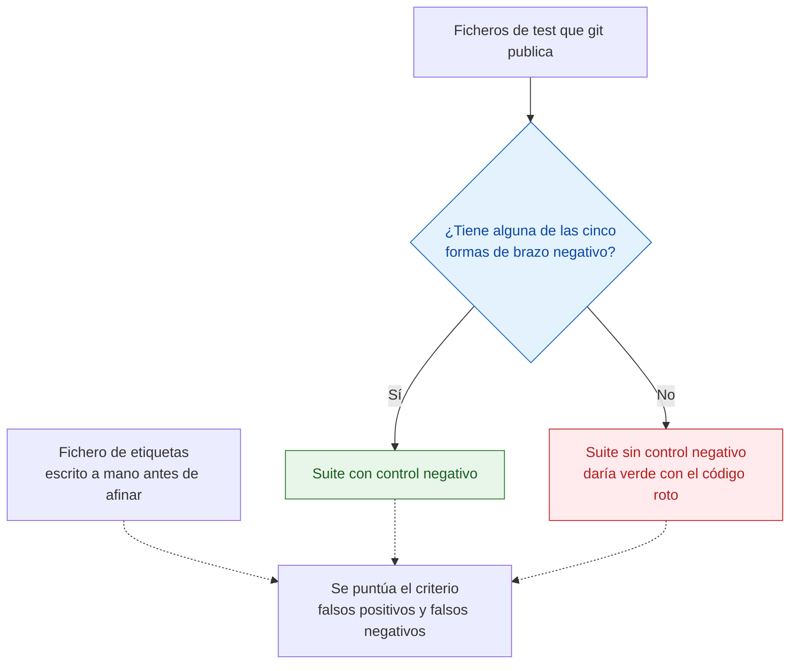

English version: [README.en.md](README.en.md)

# skill-detector-control-negativo

> Este repositorio es el paquete que se instala como plugin de Claude Code. El método y las cifras están en [detector-control-negativo](https://github.com/jleonceo/detector-control-negativo).

**Tu suite de pruebas está verde. La pregunta que nadie hace es si esa suite sabría ponerse roja.
Esta skill cuenta cuántas suites de tu repositorio comprueban solo que lo bueno pasa, dice cuáles
y por qué. Y se puntúa a sí misma contra un conjunto etiquetado a mano antes de opinar de nada.**

Aquí, **suite** es cada uno de esos ficheros, y **brazo negativo** es el caso que uno de
ellos mete a propósito para que falle. Sin brazo negativo, una suite da verde con el
código bueno y con el roto, así que su verde no informa de nada. El programa, en sus salidas y en
la clave del YAML, los llama `banco`.

Y una **skill** es una extensión de Claude Code, el agente de terminal de Anthropic: le enseña a
usar esta herramienta sin que tengas que recordar el comando. Si no usas Claude Code, la vía de
instalación manual de más abajo te vale igual.


[](https://github.com/jleonceo/skill-detector-control-negativo/actions/workflows/ci.yml)


```
/plugin marketplace add jleonceo/skill-detector-control-negativo
/plugin install detector-control-negativo@skill-detector-control-negativo
```

Esto es lo que devuelve: las **32 líneas** que imprime el comando, sin quitar ninguna. Sale del
ejemplo que viaja dentro del repositorio, así que se reproduce con `python
skills/detector-control-negativo/verificar_control_negativo.py --etiquetas
ejemplo/etiquetas_ejemplo.yaml --listar`, y se cuenta con `| wc -l`:

```
==============================================================================
BANCOS SIN CONTROL NEGATIVO
==============================================================================
  bancos con casos propios .. 8
  agregadores ............... 1  (lanzan otros bancos; no tienen casos que juzgar)
  excluidos a proposito ..... 0  (no se ha pasado --excluir)
  criterio del universo ..... versionado en git + nombre test_*/run_tests*/*_test

  con control negativo ...... 6
  SIN control negativo ...... 2
  senal que dispara ......... MARCA 2 | ASSERT_NEG 2 | ESPERA_CERO 2 | NOMBRE_NEG 3 | ETIQUETA_NEG 2

  -- SIN control negativo (revisar a mano antes de creerselo) --
     ejemplo/bancos/test_prosa_con_no_y_sin.py
     ejemplo/bancos/test_solo_positivo.py

  -- con control negativo, y por que --
     ejemplo/bancos/test_assert_negativo.py                     ASSERT_NEG,NOMBRE_NEG
     ejemplo/bancos/test_espera_cero.py                         ESPERA_CERO
     ejemplo/bancos/test_marca_cn.py                            MARCA
     ejemplo/bancos/test_nombre_negativo_aislado.py             NOMBRE_NEG
     ejemplo/bancos/test_veredicto_malo.py                      ETIQUETA_NEG
     skills/detector-control-negativo/test_detector_control_negativo.py MARCA,ASSERT_NEG,ESPERA_CERO,NOMBRE_NEG,ETIQUETA_NEG

------------------------------------------------------------------------------
  EL DETECTOR CONTRA LAS ETIQUETAS  (9 etiquetadas de 9 bancos)
    concuerda ............... 9 de 9

  >> El detector concuerda con todas las etiquetas.
     Bancos sin control negativo hoy: 2 de 8.
     La cifra se REPORTA y no tumba nada: en el arbol donde nacio bajo de 112 a
     ~10 en cinco pasadas, o sea que actuar sobre ella sin anclarla sale caro.
```

Fíjate en las dos últimas líneas antes de fijarte en el recuento: **el código de salida habla del
detector y no del repositorio.** Sale con `0` cuando concuerda con las etiquetas. El número de
suites se reporta sin tumbar nada. Esa advertencia la imprime el propio programa, en cada ejecución,
para que no dependa de que alguien se acuerde de escribirla. El porqué está más abajo y es la
decisión que da forma al resto.

**Y el «2 de 8» no describe un repositorio de verdad: los ocho suites de `ejemplo/bancos/` están
plantados a propósito, uno a uno, con su etiqueta al lado.** Dos sin brazo negativo, que son los
dos que el informe señala; cinco con brazo negativo, uno por cada señal; y un agregador, para el
tercer valor de la etiqueta. El noveno suite del universo es el de la propia skill. Es un árbol de
juguete, construido para que cada veredicto se pueda comprobar leyendo el fichero. Sobre tu
repositorio el reparto será otro.

**Eso tiene una consecuencia práctica que conviene saber antes de clonar:** esas fixtures son el
material que el detector MIDE, así que varias invocan símbolos que no existen a propósito y se
caerían si alguien las ejecutara como pruebas. Se llaman `test_*.py` porque el criterio del detector
es el nombre del fichero, y renombrarlas las sacaría de su propia medición. La exclusión vive en
`conftest.py`, con el motivo escrito dentro. Hoy `python -m pytest -q` sobre este repositorio
recoge las 38 pruebas del suite de la skill y sale verde sin tocar una sola fixture.

Este repositorio es solo el paquete instalable. La medición sobre un árbol real, con las cifras,
el método y las cuatro mutaciones que se le pasaron al propio detector, vive aparte:
[jleonceo/detector-control-negativo](https://github.com/jleonceo/detector-control-negativo).

## Qué hace



Cuenta suites y dice por qué cada uno.

A una suite que solo comprueba el camino bueno se le pasa una entrada correcta, se comprueba que
sale el resultado correcto y ahí acaba. Esa suite da verde y sigue dando verde cuando alguien
rompe la validación de entrada, porque nunca se le pregunta qué hace con una entrada mala. Le
falta el **control negativo**: el caso que afirma lo que la herramienta debe rechazar, bloquear,
dejar vacío o marcar como inválido.

La skill recorre los ficheros de test que git publica en tu repositorio, busca cinco formas de
brazo negativo y devuelve cuántas suites no tienen ninguna.

Eso es todo. Sin modelo de lenguaje de por medio, sin red, sin dependencias y sin escribir en
ningún sitio.

## Instalación

Tres vías. La primera es la corta y la última funciona siempre.

```bash
# 1. Como plugin de Claude Code
/plugin marketplace add jleonceo/skill-detector-control-negativo
/plugin install detector-control-negativo@skill-detector-control-negativo

# 2. Copiando la carpeta a tus skills personales
git clone https://github.com/jleonceo/skill-detector-control-negativo
cp -r skill-detector-control-negativo/skills/detector-control-negativo ~/.claude/skills/

# 3. Sin instalar nada, ejecutando el script directamente
python skills/detector-control-negativo/verificar_control_negativo.py --raiz .
```

El ejemplo de `ejemplo/` se ejecuta sin que tengas que preparar nada y es de donde sale el bloque
de salida del principio de esta página:

```bash
python skills/detector-control-negativo/verificar_control_negativo.py \
  --etiquetas ejemplo/etiquetas_ejemplo.yaml --listar
```

La tercera vía existe porque el instrumento no necesita a Claude Code. Es un script de biblioteca
estándar que le pregunta el universo a `git ls-files`. Si lo único que quieres es el número, te lo
da sin tocar tu configuración.

## Uso

```bash
cd tu-repositorio
python ~/.claude/skills/detector-control-negativo/verificar_control_negativo.py --etiquetar
```

**La primera ejecución en un repositorio nuevo sale con `2`, y está bien que lo haga.** Todavía no
hay etiquetas. Sin ellas el recuento es una aproximación sin puntuar. El camino es
`--etiquetar`, que imprime la plantilla YAML de las suites que aún no tienen etiqueta, abrir a
mano los ficheros que salgan y escribir la etiqueta con la línea que la demuestra. Ese rato es el
trabajo y no hay atajo: medir una suite obliga a leerlo.

Estas son las cinco opciones, que son todas:

| Opción | Para qué |
|---|---|
| `--raiz RUTA` | el árbol a medir; por defecto, la raíz git del directorio actual |
| `--etiquetas FICHERO` | la verdad de referencia con la que se puntúa el detector |
| `--excluir SUBCADENA` | deja fuera las rutas que la contengan; repetible y se cuentan aparte |
| `--listar` | cada suite con su veredicto y cada veredicto con la señal que lo disparó |
| `--etiquetar` | plantilla YAML de las suites que aún no tienen etiqueta |

La primera vez, `--listar`.

Esa vista es la que evita el malentendido más caro. La skill reconoce el brazo negativo por
formas, y las de tu proyecto no tienen por qué parecerse a las de nadie: si tu suite envuelve la
aserción en un helper propio con otro nombre, o marca sus casos negativos con una convención
distinta, `--listar` lo enseña de un vistazo. Cada suite cubierta sale con la señal que lo
disparó, así que se ve si el criterio está reconociendo lo que tú entiendes por brazo negativo o
está contando otra cosa.

## El fichero de etiquetas

```yaml
etiquetas:
  - banco: tests/test_parser.py
    tiene_control_negativo: true
    evidencia: "self.assertRaises(ValueError) en test_rechaza_cabecera_vacia"
    etiquetado_el: 2026-07-30
```

Con eso, una versión nueva del criterio **ya no se juzga por dar un número más pequeño**: se
puntúa. Falsos positivos son los que señala y sí tenían brazo negativo; falsos negativos, los que
da por buenos y no lo tienen. Un criterio que baja el titular subiendo los falsos negativos es
peor, aunque el titular quede mejor.

**Y la etiqueta se escribe antes de tocar el criterio.** Al revés, la etiqueta se acomoda al
instrumento y la medición deja de valer. Si el detector discrepa de una etiqueta tuya, lo que se
arregla es el criterio.

`tiene_control_negativo` tiene un tercer valor, `agregador`, que no es un adorno: hay ficheros que
se llaman como una suite y no tienen un solo caso propio, porque descubren otros y los lanzan.
Contarlos entre los carentes es contar el objeto equivocado.

## Los códigos de salida

| salida | qué significa |
|---|---|
| `0` | el detector concuerda con todas las etiquetas |
| `1` | discrepa de alguna: hay un falso positivo o un falso negativo |
| `2` | no hay etiquetas con las que medirse, así que no se puntúa |
| `3` | no hay universo: ninguna raíz de git, o cero suites encontradas |

**Ninguno habla del estado de tu repositorio. Es deliberado.** El primer intento de medir esto
dio 112 suites carentes, luego 77, luego 48, luego 31, y una revisión a mano de tres casos dejó la
cifra de verdad en unos diez. Ninguna versión estaba mal programada: cada afinado medía un objeto
distinto. Actuar sobre una cifra que solo baja conforme se mira mejor es el error que esta
herramienta existe para no repetir, así que el recuento se reporta y quien quiera un umbral que
bloquee lo pone él, sabiendo lo que hace.

El `3` es igual de deliberado. Fuera de un repositorio de git no hay universo, y decir «0 suites
sin control negativo» ahí sería el falso verde de manual: el mensaje más tranquilizador posible
producido por no haber mirado nada.

## Qué no hace

- No escribe. Ni en tus suites, ni en tu configuración, ni fuera de la carpeta desde la que se
  ejecuta. No propone parches ni arregla nada.
- No dice si una suite es bueno. Tener una aserción negativa no prueba que discrimine: una suite
  puede llevar `assertFalse` y seguir pasando con el código roto. Eso lo dice mutar el código.
  El paquete trae `mutar.py` para hacérselo a sí mismo.
- No cuenta lo que git no publica. El universo sale de `git ls-files`, así que una suite del
  árbol de trabajo que nadie ha añadido queda fuera. Es un suelo declarado.
- No entra por un nombre que no parezca una suite. El criterio es `test_*.py`,
  `run_tests*.py` o `*_test.py`. Otro esquema de nombres necesita otro criterio.

## Desinstalar

```bash
# si la instalaste como plugin: son DOS comandos, no uno
/plugin uninstall detector-control-negativo@skill-detector-control-negativo
/plugin marketplace remove skill-detector-control-negativo

# si copiaste la carpeta
rm -rf ~/.claude/skills/detector-control-negativo
```

El segundo comando es el que casi nadie documenta. Desinstalar el plugin lo quita de la lista de
plugins, pero deja el marketplace registrado y su copia local en la caché que mantiene Claude Code
bajo `~/.claude/plugins/`, que es suya y no de esta skill.

De la skill en sí no queda nada, porque no escribe nada: ni base de datos, ni fichero de estado,
ni configuración fuera de su carpeta.

## Por qué fiarse

**44 casos. Siete de ellos son controles negativos marcados `CN`.** En una suite cuyo objeto es
cazar suites sin control negativo, no tenerlos sería la ironía más cara del paquete.

```bash
python skills/detector-control-negativo/test_detector_control_negativo.py
python skills/detector-control-negativo/mutar.py
```

El segundo comando es el que da derecho a presumir del primero. Sabotea el detector a propósito
con **seis sabotajes** y cuenta cuántos caza la suite. Hoy caza los seis sin un hueco. No hay que
creérselo: se ejecuta y se ve. El fichero medido queda restaurado al terminar y también si el
proceso muere a mitad, porque la copia intacta vive en disco y no en la memoria del programa.

Eso hizo falta. Antes de publicar se le pasaron cuatro mutaciones al detector y **dos no rompieron
ni un test**: borrar el literal `_CN_` del reconocimiento de la marca y borrar los nombres `_no_`
y `_sin_` de la señal de nombre salían limpias, porque cada una dependía en exclusiva de un único
suite que no estaba etiquetado. Un batería de 24 casos, verde, con dos líneas del criterio que
cualquiera podía borrar sin que nadie se enterase. Se cerró con dos casos que aíslan cada forma.
La suite pasó de 24 a 26. Los cuatro que faltan hasta 30 los añadió este empaquetado y los dos
últimos, hasta 32, entraron al vigilar el censo de fixtures y el mutador. Cubren lo
que antes no existía o estaba clavado dentro del script: que las suites plantadas a propósito se
cacen, que ninguna suite del repositorio se quede sin etiqueta, que la raíz de git no se invente
cuando no hay ninguna y que la exclusión declarada saque las rutas y las cuente aparte.

**Los seis últimos, hasta los 38 de hoy, los trajo una auditoría externa el día de publicar**, con
la suite en 32, la mutación en 6 de 6 y el acuerdo con las etiquetas en 9 de 9. Buscó con material
que no estaba en la suite y encontró dos defectos que ninguno de esos tres verdes podía ver: la
señal de nombre casaba por subcadena, así que «protocolo» disparaba por contener «roto», y el lector
de etiquetas convertía en `false` cualquier valor que no entendiera, incluida su propia plantilla
sin rellenar. La lección va escrita porque cuesta verla: la mutación solo vigila las líneas que ya
existen, y el acuerdo se mide contra un árbol de juguete sin un solo nombre adversarial ni una
etiqueta mal escrita. Un arnés hereda el punto ciego del corpus que lo alimenta.

Y el mutador **falla cerrado**: si el ancla de un sabotaje ya no aparece en el fichero, esa
mutación no se aplica y, en vez de contarla como cazada, sale con ERROR y tumba la ejecución. Un
arnés que aprueba sin haber mordido no avala nada.

## Requisitos

Python 3.9 o superior, biblioteca estándar, sin red y sin nada que instalar. Ese «nada que
instalar» cubre el instrumento y su batería de 44 casos, que se ejecutan con `python` a secas. El
único comando de esta página que pide algo de fuera es el `pytest` con el que se comprueba un clon
recién hecho, y el propio CI lo instala aparte. Hace falta `git` en
el PATH, porque el universo de suites se le pregunta a él. En macOS y en casi todo Linux el
intérprete se llama `python3`, no `python`: los comandos de esta página van con `python` porque se
escribieron en Windows.

Ese «sin red» es de la skill. Hay que apurarlo porque el repositorio no cumple lo mismo que ella.
`verificar_control_negativo.py` y `mutar.py` no abren un socket: lo que necesitan se lo preguntan a
`git` en local. El que sí sale a la red es `guardian_gemelo.py`, en la raíz del repositorio, que
consulta `api.github.com` para comparar este paquete con su gemelo. No se instala con la skill y no
participa en ninguna medición.

Ese 3.9 estuvo **declarado y sin certificar** hasta el 31/07/2026. Esta nota se corrige en vez de
borrarse porque así estaba prometido. En local solo se había ejecutado con Python 3.10, 3.13 y 3.14,
las tres sobre Windows, o sea en ninguna versión por debajo de 3.10, que era la que importaba. Un
repaso del código no encontraba sintaxis ni biblioteca por encima de 3.9, pero eso encuentra
incompatibilidades sin certificar compatibilidad.

Lo que la certifica es la matriz de CI, y el primer push la puso en verde entera: **nueve
combinaciones, 3.9, 3.11 y 3.13 sobre Windows, Linux y macOS**, más el trabajo que compara este
paquete con su gemelo. El 3.9 ya está certificado por ejecución.

## Piezas hermanas

- **[detector-control-negativo](https://github.com/jleonceo/detector-control-negativo)**: el mismo
  instrumento con el método, las cifras sobre un árbol real y la especificación que se aceptó
  antes de escribir el código.
- **[skill-adherencia-reglas](https://github.com/jleonceo/skill-adherencia-reglas)**: la otra skill
  del mismo laboratorio. Cuenta qué fracción de las reglas que escribiste para tu agente se cumple
  de verdad.
- **[guardianes-verificados-ia](https://github.com/jleonceo/guardianes-verificados-ia)**: quién
  vigila a los guardianes. Un detector que encuentra el problema y no devuelve el código de salida
  que bloquea no protege nada.

---

## Licencia

MIT. Ver [LICENSE](LICENSE).
